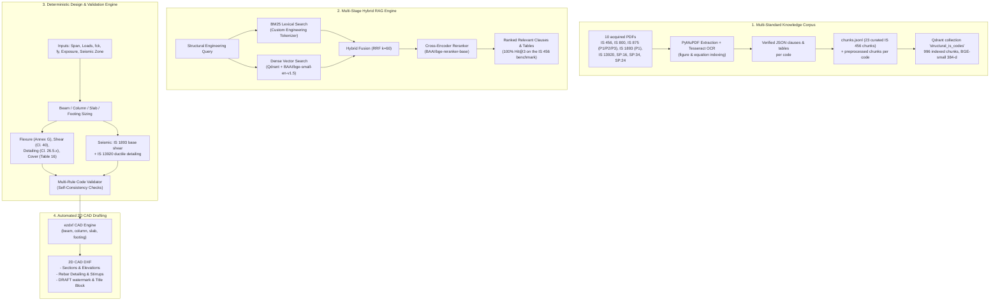

# IS-Code-RAG: Multi-Standard Structural Indian Standards RAG & AI-Driven 2D CAD Engine

A Retrieval-Augmented Generation (RAG) pipeline and deterministic engineering engine over structural Indian Standards (**IS 456, IS 800, IS 875, IS 1893, IS 13920**, plus the SP:16, SP:34 and SP:24 BIS handbooks). The system pairs multi-standard clause retrieval with deterministic sizing of RC beams, columns, slabs and isolated footings, seismic base shear and ductile-detailing compliance, structural design validation, and 2D CAD DXF drafting.

---

## Key Highlights

- **Multi-Standard Corpus**: 10 acquired documents (7 Indian Standards + 3 BIS handbooks), recorded with publisher, edition, amendments and SHA-256 hashes in `data/raw/registry.json`. Five codes are vector-indexed: IS 456:2000, IS 13920:2016, IS 1893 (Part 1):2016, IS 875 (Part 2):1987 and IS 800:2007.
- **23 Human-Verified IS 456 Chunks**: The core beam design clauses and tables were extracted from the original standard pages and manually checked against page images, with verified citations and printed headings.
- **Qdrant-Backed Hybrid Retrieval**: Lexical search (**BM25Okapi**) + dense semantic embeddings (**BAAI/bge-small-en-v1.5**, embedded Qdrant collection of **996** chunks) + Reciprocal Rank Fusion (**RRF $k=60$**) + Cross-Encoder reranking (**BAAI/bge-reranker-base**).
- **Deterministic Structural Engineering**: Beam, column, slab and footing sizing (Annex G flexure, Cl. 39/40 shear, Cl. 26.5.x detailing, Table 16 cover) is computed in Python from verified JSON tables. **Calculations are executed deterministically without LLM generation.**
- **Seismic Design Checks**: IS 1893 (Part 1) base shear $V_B = A_h W$ and IS 13920 ductile detailing, applied where seismic provisions supersede IS 456 in Zones III–V.
- **100% Top-3 Retrieval Recall**: Achieves **100.0% Hit@3 (19/19)** and **84.2% Hit@1 (16/19)** across the IS 456 beam design benchmark queries.
- **Automated 2D CAD Generation**: Generates AutoCAD-compatible DXF files (`ezdxf`) for beams, columns, slabs and footings — sections, elevations, stirrup distributions, dimensions and standardized non-overlapping title blocks with automatic word-wrapped compliance notes. Every drawing is stamped **DRAFT - NOT FOR CONSTRUCTION** until a signed review record exists.
- **Interactive Web Application**: A modern React 19 + TypeScript + Vite + Tailwind CSS frontend featuring a 4-member Design Studio, multi-standard IS Code Search, CAD Drawings layer specification guide, Engineer Review signoff portal, and an Observability telemetry dashboard.
- **FastAPI Service**: Authenticated REST API (`X-API-Key`) with 14 endpoints covering retrieval, multi-code search, design review, DXF export, seismic compliance and base shear, plus audit logging to `data/audit/audit.jsonl`.
- **Automated Tests**: 252 automated tests covering schemas, math functions, CAD generation, API endpoints, retrieval, evaluation and deployment manifests.

---

## System Architecture



---

## IS 456:2000 Knowledge Base (23 Verified Chunks)

All 23 chunks in `data/processed/chunks.jsonl` are strictly verified against official standard pages:

| Chunk ID | Clause / Table | Title / Printed Heading | Role in Beam Design |
| :--- | :--- | :--- | :--- |
| `IS456-2000-CL-26.5.1.1(a)` | Cl. 26.5.1.1(a) | Minimum tension reinforcement | Tension steel floor: $A_s/(bd) \ge 0.85/f_y$ |
| `IS456-2000-CL-26.5.1.1(b)` | Cl. 26.5.1.1(b) | Maximum tension reinforcement | Tension steel ceiling: $A_s \le 0.04bD$ |
| `IS456-2000-CL-26.5.1.2` | Cl. 26.5.1.2 | Compression reinforcement | Compression steel ceiling: $A_{sc} \le 0.04bD$ |
| `IS456-2000-CL-26.5.1.3` | Cl. 26.5.1.3 | Side face reinforcement | Web depth $> 750\text{ mm}$ requirement ($0.1\%$) |
| `IS456-2000-CL-26.5.1.4` | Cl. 26.5.1.4 | Transverse reinforcement for shear/torsion | Outer bar enclosure requirements |
| `IS456-2000-CL-26.5.1.5` | Cl. 26.5.1.5 | Maximum spacing of shear reinforcement | Spacing limit: $\min(0.75d, 300\text{ mm})$ |
| `IS456-2000-CL-26.5.1.6` | Cl. 26.5.1.6 | Minimum shear reinforcement | Stirrup minimum steel limit formula |
| `IS456-2000-CL-26.5.1.7` | Cl. 26.5.1.7 | Distribution of torsion reinforcement | Closed stirrups spacing for torsion |
| `IS456-2000-CL-26.5.1.8` | Cl. 26.5.1.8 | Reinforcement in flanges of T-beams | Flange distribution & longitudinal bars |
| `IS456-2000-TABLE-16` | Table 16 | Nominal Cover to Meet Durability | Concrete cover by exposure (20 to 75 mm) |
| `IS456-2000-TABLE-19` | Table 19 | Design Shear Strength of Concrete | Concrete shear strength $\tau_c$ (78 values) |
| `IS456-2000-TABLE-20` | Table 20 | Maximum Shear Stress | Maximum shear ceiling $\tau_{c,max}$ (M15–M40+) |
| `IS456-2000-TABLE-XU-MAX-38.1` | Cl. 38.1 Note | Limiting values of neutral axis depth | Limiting neutral axis ratio $x_{u,max}/d$ |
| `IS456-2000-ANNEX-G-G-1.1(a)` | Annex G-1.1(a) | Depth of neutral axis formula | Neutral axis calculation $x_u/d$ |
| `IS456-2000-ANNEX-G-G-1.1(b)` | Annex G-1.1(b) | Moment of resistance (under-reinforced) | $M_u$ formula for singly reinforced beams |
| `IS456-2000-ANNEX-G-G-1.1(c)` | Annex G-1.1(c) | Limiting moment of resistance | $M_{u,lim}$ limiting flexural capacity |
| `IS456-2000-ANNEX-G-G-1.1(d)` | Annex G-1.1(d) | Over-reinforced section rule | Redesign requirement if $x_u > x_{u,max}$ |
| `IS456-2000-ANNEX-G-G-1.2` | Annex G-1.2 | Doubly reinforced section formulas | Compression steel and moment balance |
| `IS456-2000-CL-40.1` | Cl. 40.1 | Nominal Shear Stress | Factored nominal shear stress $\tau_v = V_u/(bd)$ |
| `IS456-2000-CL-40.2.3` | Cl. 40.2.3 | With Shear Reinforcement | Physical limit: $\tau_v \le \tau_{c,max}$ Table 20 |
| `IS456-2000-CL-40.3` | Cl. 40.3 | Minimum Shear Reinforcement | Minimum shear steel rule when $\tau_v < \tau_c$ |
| `IS456-2000-CL-40.4` | Cl. 40.4 | Design of Shear Reinforcement | Shear carried by stirrups $V_{us} = V_u - \tau_c bd$ |
| `IS456-2000-CL-40.4(a)` | Cl. 40.4(a) | Vertical stirrups design | Vertical stirrup spacing: $V_{us} = \frac{0.87 f_y A_{sv} d}{s_v}$ |

---

## Multi-Standard Knowledge Base (996 Indexed Chunks)

Beyond the curated IS 456 beam set, the retrieval index covers four further codes. `data/raw/registry.json` records all 10 acquired documents with publisher, edition, amendments (where applicable) and SHA-256 hashes:

| Code | Title | Category | In the vector index |
| :--- | :--- | :--- | :--- |
| IS 456:2000 | Plain and Reinforced Concrete — Code of Practice | core concrete | Yes (23 curated chunks) |
| IS 13920:2016 | Ductile Design and Detailing of RC Structures Subjected to Seismic Forces | seismic ductility | Yes |
| IS 1893 (Part 1):2016 | Criteria for Earthquake Resistant Design of Structures | seismic criteria | Yes |
| IS 875 (Part 2):1987 | Design Loads — Part 2: Imposed Loads | design loads | Yes |
| IS 800:2007 | General Construction in Steel | structural steel | Yes |
| IS 875 (Part 1):1987 | Design Loads — Part 1: Dead Loads | design loads | Acquired, not indexed |
| IS 875 (Part 3):2015 | Design Loads — Part 3: Wind Loads | design loads | Acquired, not indexed |
| SP:16:1980, SP:34:1987, SP:24:1983 | BIS design aids, reinforcement detailing and explanatory handbooks | handbook | Acquired, not indexed |

The Qdrant collection `structural_is_codes` holds **996** chunks (BGE-small, 384-dim, cosine) drawn from the five indexed codes. Metadata payload filtering is applied on the `code` attribute, enabling single-code and cross-code queries.

---

## Retrieval Engine Benchmark Performance

Evaluated against 19 structural engineering benchmark queries covering flexure, shear, detailing, and cover:

```text
===============================================================================================
RANK COMPARISON: BM25 vs DENSE vs HYBRID vs RERANK (All 19 Benchmark Queries)
===============================================================================================
#    | Question                                   | BM25   | Dense  | Hybrid | Rerank
-------------------------------------------------------------------------------------
Q1   | minimum tension reinforcement in a beam    | 1      | 1      | 1      | 1     
Q2   | maximum tension reinforcement in a beam    | 2      | 2      | 2      | 1     
Q3   | maximum compression reinforcement in a ... | 2      | 1      | 1      | 1     
Q4   | side face reinforcement when web depth ... | 1      | 1      | 1      | 1     
Q5   | transverse reinforcement around outer-m... | 1      | 1      | 1      | 1     
Q6   | maximum spacing of vertical stirrups       | 1      | 1      | 1      | 1     
Q7   | minimum shear reinforcement formula for... | 3      | 1      | 1      | 1     
Q8   | spacing of closed stirrups for torsion     | 1      | 1      | 1      | 1     
Q9   | reinforcement in flanges of T-beams        | 1      | 1      | 1      | 1     
Q10  | nominal cover for moderate exposure        | 1      | 1      | 1      | 1     
Q11  | design shear strength of concrete M25      | 1      | 1      | 1      | 1     
Q12  | maximum shear stress for M25 concrete      | 1      | 1      | 1      | 1     
Q13  | limiting neutral axis depth for Fe500      | 1      | 1      | 1      | 1     
Q14  | moment of resistance of a rectangular s... | 4      | 2      | 3      | 3     
Q15  | limiting moment of resistance of a rect... | 2      | 1      | 1      | 1     
Q16  | nominal shear stress in a beam             | 1      | 2      | 1      | 1     
Q17  | shear to be carried by stirrups when no... | 1      | 5      | 1      | 2     
Q18  | strength of vertical stirrups              | 1      | 1      | 1      | 1     
Q19  | nominal shear stress must not exceed ma... | 1      | 2      | 1      | 2     
===============================================================================================
```

- **Cross-Encoder Reranker**: **Hit@1 = 84.2% (16/19)** | **Hit@3 = 100.0% (19/19)**
- **Hybrid Fusion (RRF $k=60$)**: **Hit@1 = 89.5% (17/19)** | **Hit@3 = 100.0% (19/19)**

---

## Deterministic Beam Sizing & Validation

The design module (`src/generation/beam_sizing.py`) follows standard Limit State Design per IS 456:2000:

1. **Loads & Factored Forces**:
   - $w = 1.5 \times (DL + LL + \text{self-weight})$
   - Factored Bending Moment: $M_u = \frac{w L^2}{8}$
   - Factored Shear Force: $V_u = \frac{w L}{2}$
2. **Section Sizing**:
   - Depth requirement: $d \ge \sqrt{\frac{M_u}{R_u b}}$ where $R_u = 0.36 f_{ck} \frac{x_{u,max}}{d} (1 - 0.42 \frac{x_{u,max}}{d})$
   - Overall depth: $D = d + \text{cover} + \frac{\Phi_{bar}}{2} + \Phi_{stirrup}$
3. **Flexural Reinforcement (Annex G)**:
   - Required steel: $A_{st} = \frac{0.5 f_{ck}}{f_y} \left(1 - \sqrt{1 - \frac{4.59 M_u}{f_{ck} b d^2}}\right) b d$
   - Practical bar selection: Evaluates standard bar diameters (12, 16, 20, 25, 32 mm) to find optimal count fitting width $b$ with code spacing.
   - Ductility check: Validates section is strictly under-reinforced ($x_u \le x_{u,max}$).
4. **Shear Reinforcement (Clause 40, Table 19, Table 20)**:
   - Nominal shear stress: $\tau_v = \frac{V_u}{b d}$
   - Safety check: If $\tau_v > \tau_{c,max}$ (Table 20), section is flagged `needs_review` (section too small).
   - Concrete capacity: $\tau_c$ looked up from Table 19 based on tension steel percentage $p_t = \frac{100 A_{st}}{b d}$ and $f_{ck}$.
   - If $\tau_v \le \tau_c$: Minimum stirrup steel provided per Cl. 26.5.1.6 ($s_v \le \frac{0.87 f_y A_{sv}}{0.4 b}$).
   - If $\tau_v > \tau_c$: Shear steel designed for $V_{us} = V_u - \tau_c b d$ ($s_v = \frac{0.87 f_y A_{sv} d}{V_{us}}$).
   - Iterates 8, 10, then 12 mm two-legged stirrups to find spacing $\ge 100\text{ mm}$ capped at $\min(0.75d, 300\text{ mm})$.

---

## 2D CAD DXF Drawing Output

The CAD drafting modules (`src/cad/`) produce production-grade AutoCAD-compatible DXF drawings (`ezdxf` R2010) across all four structural members (RC Beams, RC Columns, RC Slabs, and Isolated Footings):

- **Layer Hierarchy**: Concrete outlines (`OUTLINE`), longitudinal tension rebar (`REBAR_MAIN` / Red), top hanger steel (`REBAR_TOP` / Green), closed ties & stirrups (`STIRRUPS` / Cyan), dimensions (`DIMENSIONS` / Yellow), annotations & callouts (`ANNOTATIONS` / Magenta), and title blocks (`TITLE_BLOCK` / Blue).
- **Auto-Wrapped Compliance Notes**: Engineering clauses and execution notes in the notes table are word-wrapped at 88 characters with indented continuation lines, guaranteeing that text never overflows table borders.
- **Dynamic Layout & Title Blocks**: Title blocks are positioned at the bottom-right corner of the sheet with a standard $\ge 1100\text{ mm}$ width, preventing box collisions.
- **Statutory Safety Guardrail**: Every exported CAD file carries an indelible text entity stamped on layer `DRAFT_WATERMARK`:
  `STATUS: DRAFT - NOT FOR CONSTRUCTION. Not engineer-reviewed.`

---

## Interactive Frontend Web Application

The frontend (`frontend/`) is built with React 19, TypeScript, Vite, and Tailwind CSS. It connects to the FastAPI backend via an Axios API service with client-side API key management:

1. **Design Studio (`MemberStudio.tsx`)**:
   - Interactive limit state sizing for **RC Beam**, **RC Column**, **RC Slab**, and **Isolated Footing**.
   - Solves quadratic moment formulas, shear capacities, deflection ratios, and axial limits in real time.
   - Live results cards displaying calculated bar counts, diameters, and spacing (e.g. `3 - T20 (942 mm²)`, `2L-T8 @ 130mm`).
   - One-click **"Generate 2D CAD Blueprint (.DXF)"** and direct file download.
2. **IS Code Search (`ISCodeSearch.tsx`)**:
   - Semantic natural language and keyword search across 996 Qdrant chunks.
   - Code filtering tabs for **ALL**, **IS 456**, **IS 13920**, **IS 1893**, **IS 875**, and **IS 800**.
3. **CAD Drawings Viewer (`CADViewer.tsx`)**:
   - AutoCAD layer hierarchy and AIA/CPWD standard reference guide.
   - Explains statutory watermark rules and structural drafting standards across all member types.
4. **Engineer Review (`ReviewSignoff.tsx`)**:
   - Human-in-the-loop signoff portal allowing licensed engineers to review calculations, enter their statutory registration details, and stamp drawings as Reviewed.
5. **Observability (`AuditDashboard.tsx`)**:
   - Live system health telemetry, query latency metrics, and audit log event viewer.

---

## Manager Demonstration Guide (How to Run Everything)

Run these commands in PowerShell or terminal inside the workspace:

### 1. Run the Entire Test Suite (252 Tests)
```powershell
.venv\Scripts\python -m pytest tests/ -v
```
*Expected: the full suite reports as passed, covering unit checks, shear design, flexure formulas, CAD export, API, retrieval, evaluation, and deployment/Kubernetes manifests. Corpus integrity tests report as skipped when the raw PDFs have not been restored with `dvc pull`.*

### 2. Run the Cross-Encoder Retrieval Benchmark (All 19 Questions)
```powershell
.venv\Scripts\python -m src.evaluation.run_rerank_eval
```
*Expected: Evaluates BM25, Dense, Hybrid, and Reranker against the 19 benchmark questions (100% Hit@3).*

### 3. Run the End-to-End Structural Design Evaluation Benchmark
```powershell
.venv\Scripts\python src/evaluation/run_design_eval.py
```
*Expected: Evaluates 5 realistic building scenarios (residential, commercial, retail, school, marine). Validates self-consistency checks, Table 19 arithmetic re-checks, and exports 5 CAD DXF files to `data/processed/cad/`.*

### 4. Generate a Beam Design & CAD DXF Drawing On-Demand
Run this one-liner to size a custom beam and output a CAD drawing:
```powershell
.venv\Scripts\python -c "from src.cad.beam_dxf import export_dxf_from_loads; res = export_dxf_from_loads(span_m=5.0, dead_load_kN_per_m=12.0, live_load_kN_per_m=8.0, fck=25, fy=415, exposure='moderate', output_path='data/processed/cad/demo_beam.dxf'); print('Status:', res['status']); print('DXF Generated:', res['dxf_path']); print('Section:', res['sizing']['section_dimensions']); print('Bottom Bars:', res['sizing']['reinforcement_detailing']['main_bar_count'], 'x T', res['sizing']['reinforcement_detailing']['main_bar_dia_mm']); print('Stirrups:', res['sizing']['reinforcement_detailing']['stirrup_dia_mm'], 'mm @', res['sizing']['reinforcement_detailing']['stirrup_spacing_mm'], 'mm c/c')"
```
*Expected: Output DXF drawing created at `data/processed/cad/demo_beam.dxf`.*

### 5. Start the FastAPI Service
```powershell
.venv\Scripts\python -m uvicorn src.api.main:app --port 8000
```
Open another terminal to test the endpoints:
- **Health Check**:
  ```powershell
  Invoke-RestMethod -Uri "http://localhost:8000/health"
  ```
- **Authenticated RAG Query**:
  ```powershell
  Invoke-RestMethod -Uri "http://localhost:8000/v1/rag/query" -Method POST -Headers @{"X-API-Key"="FAKE_DEMO_KEY_FOR_LOCAL_TESTING_ONLY"; "Content-Type"="application/json"} -Body '{"query": "nominal shear stress in a beam", "k": 3}'
  ```

### 6. Start the Interactive Frontend Web UI
```powershell
cd frontend
npm install
npm run dev
```
Open your browser at **`http://localhost:5173`**:
- Navigate to **Design Studio** to enter spans and loads, compute live reinforcement schedules, and download 2D CAD `.dxf` files.
- Navigate to **IS Code Search** to test semantic clause lookups across Indian Standards.
- Navigate to **Observability** to monitor live query latency and audit events.

---

## Directory Structure

```text
IS-Code-Rag/
├── frontend/                         # React 19 + TypeScript + Vite + Tailwind UI
│   ├── src/
│   │   ├── components/               # MemberStudio, ISCodeSearch, CADViewer, ReviewSignoff, AuditDashboard
│   │   ├── services/                 # Axios API service & key management
│   │   └── types/                    # TypeScript interfaces for design & RAG responses
│   ├── package.json
│   └── vite.config.ts
├── .github/workflows/ci.yml          # CI: test suite, corpus restore, image build & publish
├── k8s/                              # Kubernetes manifests (namespace, config, secret,
│                                     # PostgreSQL StatefulSet, API Deployment/Service/PVCs)
├── Dockerfile                        # python:3.12-slim image, non-root user, /health check
├── docker-compose.yml                # Local single-service Compose deployment
├── data/
│   ├── audit/                        # Append-only secure query audit log
│   │   └── audit.jsonl
│   ├── eval/                         # Benchmark scenarios, reviews & evaluation reports
│   │   ├── design_evaluation_report.json
│   │   ├── engineer_review_package.json
│   │   ├── independent_review_package.json
│   │   ├── questions.json            # 19 benchmark retrieval queries
│   │   ├── rag_metrics_report.json
│   │   ├── sp16_worked_examples.json
│   │   ├── step9_master_evaluation_report.json
│   │   └── structural_design_scenarios.json
│   ├── raw/                          # DVC-tracked source PDFs (not committed) + registry
│   │   ├── registry.json             # 10 acquired documents, editions & SHA-256 hashes
│   │   └── *.pdf.dvc                 # DVC pointer files
│   └── processed/                    # Verified clauses, JSON tables, indices & DXF outputs
│       ├── cad/                      # Generated 2D CAD DXF drawings
│       ├── qdrant_storage/           # Embedded Qdrant collection (996 chunks)
│       ├── chunks.jsonl              # 23 verified IS 456 chunks
│       ├── embeddings.npy            # Normalized dense vector embeddings (IS 456 subset)
│       ├── embedding_ids.json
│       ├── figures_equations.json    # Extracted figure/equation index
│       ├── is456_*.json              # Verified IS 456 clauses & tables
│       ├── is800_preprocessed.json   # Preprocessed multi-standard corpora
│       ├── is13920_*.json
│       ├── is1893_part_1_*.json
│       └── is875_part_2_*.json
├── docs/                             # Architecture, data schema, deployment, maintenance
├── src/
│   ├── api/                          # FastAPI service, API-key security & audit logging
│   │   └── main.py
│   ├── cad/                          # 2D CAD DXF drafting engines (ezdxf)
│   │   ├── beam_dxf.py
│   │   ├── column_dxf.py
│   │   ├── slab_dxf.py
│   │   ├── footing_dxf.py
│   │   └── engineer_review.py        # Review records & DRAFT/Reviewed watermarking
│   ├── chunking/                     # Chunk compiler & Pydantic schema
│   │   ├── build_chunks.py
│   │   └── schema.py
│   ├── evaluation/                   # Retrieval, design, grounding & review benchmarks
│   │   ├── rag_metrics.py            # Offline RAGAS-style proxy metrics
│   │   ├── run_dense_eval.py
│   │   ├── run_design_eval.py
│   │   ├── run_engineer_review.py
│   │   ├── run_hybrid_eval.py
│   │   ├── run_independent_review.py # Blind review package generator
│   │   ├── run_rag_metrics_eval.py
│   │   ├── run_rerank_eval.py
│   │   ├── run_retrieval_eval.py
│   │   ├── run_sp16_eval.py
│   │   └── run_step9_master_eval.py  # Master evaluation driver
│   ├── generation/                   # Sizing algorithms & design engines
│   │   ├── beam_sizing.py
│   │   ├── column_sizing.py
│   │   ├── slab_sizing.py
│   │   ├── footing_sizing.py
│   │   ├── seismic_base_shear.py     # IS 1893 base shear calculator
│   │   ├── design_assistant.py       # LLM tool-calling front-end
│   │   ├── design_proposal.py        # Retrieval-backed detailing proposal
│   │   ├── design_validation.py
│   │   └── llm_client.py
│   ├── ingestion/                    # PDF acquisition, extraction, OCR & figure indexing
│   ├── retrieval/                    # Search modules (BM25, Qdrant, Hybrid, Rerank)
│   │   ├── bm25_search.py
│   │   ├── dense_search.py
│   │   ├── hybrid_search.py
│   │   ├── multicode_search.py       # Multi-standard RRF search over Qdrant
│   │   ├── pipeline.py
│   │   ├── qdrant_db.py              # Embedded Qdrant vector store
│   │   └── rerank.py
│   ├── storage/                      # PostgreSQL persistence for standards & audit
│   └── validation/                   # Deterministic calculation & seismic modules
│       ├── is456_checks.py
│       ├── is456_flexure.py
│       ├── is456_shear.py
│       └── seismic_compliance.py
└── tests/                            # 252 automated pytest unit & integration tests
```

---

## Phase 2 (Pillar 1): Full Building Frame Members

Phase 2 expands the proven deterministic 5-stage architecture beyond horizontal beams to deliver complete building superstructure and foundation design:

```
[ Floor Slabs ]  (IS 456 Cl. 24 & 26.5.2)  --> Dead & Live Gravity Loads
       │
       ▼
  [ RC Beams ]   (IS 456 Cl. 26.5.1, Annex G) --> Transfer Moments & Shears
       │
       ▼
 [ RC Columns ]  (IS 456 Cl. 39 & 26.5.3)  --> Axial Compression & Lateral Ties
       │
       ▼
 [ RC Footings ] (IS 456 Cl. 34 & 31.6.3)  --> Punching Shear & Soil Bearing
       │
       ▼
   [ Ground ]    (Safe Soil Bearing Capacity)
```

### 1. Reinforced Concrete Columns (IS 456 Cl. 39 & Cl. 26.5.3)
- **Axial Compression**: Factored capacity $P_u = 0.4 f_{ck} A_c + 0.67 f_y A_{sc}$ (Cl. 39.3).
- **Slenderness Ratio**: Verified $L_{eff}/D < 12$ and $L_{eff}/b < 12$ for short column behavior (Cl. 25.1.2).
- **Minimum Eccentricity**: Calculated $e_{min} = \max(L/500 + D/30, 20\text{ mm}) \le 0.05 D$ (Cl. 25.4 & 39.1).
- **Longitudinal Steel**: Codified envelope $0.8\% \le p_c \le 4.0\%$ with minimum 4 bars ($\phi \ge 12\text{ mm}$) (Cl. 26.5.3.1).
- **Lateral Confinement Ties**: Diameter $\ge \max(\phi_{max}/4, 6\text{ mm})$, pitch $\le \min(b, 16\phi_{min}, 300\text{ mm})$ (Cl. 26.5.3.2).
- **AutoCAD DXF & API**: `POST /v1/design/column/review` and `POST /v1/design/column/dxf`.

### 2. Reinforced Concrete Floor Slabs (IS 456 Cl. 24 & Cl. 26.5.2)
- **Classification**: Aspect ratio $L_y / L_x > 2.0 \implies$ One-Way Slab; $L_y / L_x \le 2.0 \implies$ Two-Way Slab (Cl. 24.2).
- **Deflection Control**: Span-to-effective-depth ratio $L/d \le (L/d)_{basic} \times F_t$ (Cl. 23.2.1).
- **Bending Moments**: One-way flexure $M_u = w_u L^2 / 8$; Two-way flexure using Table 27 coefficients ($\alpha_x, \alpha_y$).
- **Reinforcement Detailing**: Minimum steel $0.12\% b D$ (Fe 415/500), maximum diameter $\le D/8$, main bar pitch $\le \min(3d, 300\text{ mm})$, distribution bar pitch $\le \min(5d, 450\text{ mm})$ (Cl. 26.5.2).
- **Shear Safety**: Solid slab shear capacity $k \tau_c$ verified without stirrups (Cl. 40.2.1.1).
- **AutoCAD DXF & API**: `POST /v1/design/slab/review` and `POST /v1/design/slab/dxf`.

### 3. Reinforced Concrete Isolated Footings (IS 456 Cl. 34)
- **Base Plan Area**: $A \ge 1.10 P / q_a$ including 10% self-weight allowance against Safe Bearing Capacity (Cl. 34.1.2).
- **Two-Way Punching Shear**: Critical perimeter at $d/2$ from column face, $\tau_v \le k_s (0.25 \sqrt{f_{ck}})$ (Cl. 31.6.3 & Cl. 34.2.4.1).
- **One-Way Beam Shear**: Critical section at $d$ from column face, $\tau_v \le \tau_c$ (Cl. 34.2.4.1 & Table 19).
- **Flexural Reinforcement**: Bending moment at column face $M_u = q_u B a^2 / 2$ with bottom rebar mesh in both directions (Cl. 34.2.3 & 34.3.1).
- **Edge Thickness & Cover**: Minimum edge thickness $\ge 150\text{ mm}$ (Cl. 34.1.3), nominal cover $\ge 50\text{ mm}$ (Table 16).
- **AutoCAD DXF & API**: `POST /v1/design/footing/review` and `POST /v1/design/footing/dxf`.

---

## Structural Engineering Disclaimer

> **IMPORTANT**: The design calculations, automated checks, and CAD drawings produced by this software are self-consistency checks and arithmetic re-checks based on codified rules in IS 456:2000. These results do not constitute an independent validation. A licensed structural engineer must review and approve all designs before construction.

