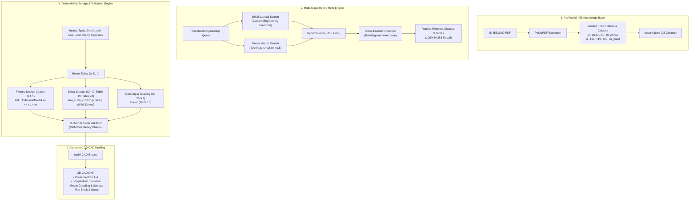

# IS-Code-RAG: Structural IS 456:2000 RAG & AI-Driven 2D CAD Engine

A Retrieval-Augmented Generation (RAG) pipeline and deterministic engineering engine for structural Indian Standards (**IS 456:2000 - Plain and Reinforced Concrete**). The system automates code-compliant Reinforced Concrete (RC) beam sizing, multi-stage clause retrieval, structural design validation, and 2D CAD DXF drafting.

---

## Key Highlights

- **Deterministic Structural Engineering**: All calculations (Annex G flexure, Clause 40 shear, Clause 26.5.1 detailing, Table 16 cover) are computed deterministically in Python from verified JSON tables. **Calculations are executed deterministically without LLM generation.**
- **23 Human-Verified IS 456 Chunks**: Every clause and table was extracted from original standard pages and manually checked against page images with verified citations and printed headings.
- **Multi-Stage Retrieval Engine**: Lexical search (**BM25Okapi**) + Dense semantic embeddings (**BAAI/bge-small-en-v1.5**) + Hybrid Reciprocal Rank Fusion (**RRF $k=60$**) + Cross-Encoder (**BAAI/bge-reranker-base**).
- **100% Top-3 Retrieval Recall**: Achieves **100.0% Hit@3 (19/19)** and **84.2% Hit@1 (16/19)** across structural design queries.
- **Automated 2D CAD Generation**: Generates standard CAD DXF files (`ezdxf`) featuring longitudinal elevations, cross-sections, stirrup distributions, dimensions, title blocks, and code compliance notes.
- **FastAPI Service**: Authenticated `/v1/rag/query` endpoint with API key verification, lifespan model preloading, and audit logging to `data/audit/audit.jsonl`.
- **Automated Tests**: Comprehensive test suite covering schemas, math functions, CAD generation, API endpoints, and evaluation benchmarks.

---

## System Architecture



---

## IS 456:2000 Knowledge Base (23 Verified Chunks)

All 23 chunks in `data/processed/chunks.jsonl` are strictly verified against official standard pages:

| Chunk ID | Clause / Table | Title / Printed Heading | Role in Beam Design |
| :--- | :--- | :--- | :--- |
| `IS456-2000-CL-26.5.1.1(a)` | Cl. 26.5.1.1(a) | Minimum tension reinforcement | Tension steel floor: $A_s/(bd) \ge 0.85/f_y$ |
| `IS456-2000-CL-26.5.1.1(b)` | Cl. 26.5.1.1(b) | Maximum tension reinforcement | Tension steel ceiling: $A_s \le 0.04bD$ |
| `IS456-2000-CL-26.5.1.2` | Cl. 26.5.1.2 | Compression reinforcement | Compression steel ceiling: $A_{sc} \le 0.04bD$ |
| `IS456-2000-CL-26.5.1.3` | Cl. 26.5.1.3 | Side face reinforcement | Web depth $> 750\text{ mm}$ requirement ($0.1\%$) |
| `IS456-2000-CL-26.5.1.4` | Cl. 26.5.1.4 | Transverse reinforcement for shear/torsion | Outer bar enclosure requirements |
| `IS456-2000-CL-26.5.1.5` | Cl. 26.5.1.5 | Maximum spacing of shear reinforcement | Spacing limit: $\min(0.75d, 300\text{ mm})$ |
| `IS456-2000-CL-26.5.1.6` | Cl. 26.5.1.6 | Minimum shear reinforcement | Stirrup minimum steel limit formula |
| `IS456-2000-CL-26.5.1.7` | Cl. 26.5.1.7 | Distribution of torsion reinforcement | Closed stirrups spacing for torsion |
| `IS456-2000-CL-26.5.1.8` | Cl. 26.5.1.8 | Reinforcement in flanges of T-beams | Flange distribution & longitudinal bars |
| `IS456-2000-TABLE-16` | Table 16 | Nominal Cover to Meet Durability | Concrete cover by exposure (20 to 75 mm) |
| `IS456-2000-TABLE-19` | Table 19 | Design Shear Strength of Concrete | Concrete shear strength $\tau_c$ (78 values) |
| `IS456-2000-TABLE-20` | Table 20 | Maximum Shear Stress | Maximum shear ceiling $\tau_{c,max}$ (M15–M40+) |
| `IS456-2000-TABLE-XU-MAX-38.1` | Cl. 38.1 Note | Limiting values of neutral axis depth | Limiting neutral axis ratio $x_{u,max}/d$ |
| `IS456-2000-ANNEX-G-G-1.1(a)` | Annex G-1.1(a) | Depth of neutral axis formula | Neutral axis calculation $x_u/d$ |
| `IS456-2000-ANNEX-G-G-1.1(b)` | Annex G-1.1(b) | Moment of resistance (under-reinforced) | $M_u$ formula for singly reinforced beams |
| `IS456-2000-ANNEX-G-G-1.1(c)` | Annex G-1.1(c) | Limiting moment of resistance | $M_{u,lim}$ limiting flexural capacity |
| `IS456-2000-ANNEX-G-G-1.1(d)` | Annex G-1.1(d) | Over-reinforced section rule | Redesign requirement if $x_u > x_{u,max}$ |
| `IS456-2000-ANNEX-G-G-1.2` | Annex G-1.2 | Doubly reinforced section formulas | Compression steel and moment balance |
| `IS456-2000-CL-40.1` | Cl. 40.1 | Nominal Shear Stress | Factored nominal shear stress $\tau_v = V_u/(bd)$ |
| `IS456-2000-CL-40.2.3` | Cl. 40.2.3 | With Shear Reinforcement | Physical limit: $\tau_v \le \tau_{c,max}$ Table 20 |
| `IS456-2000-CL-40.3` | Cl. 40.3 | Minimum Shear Reinforcement | Minimum shear steel rule when $\tau_v < \tau_c$ |
| `IS456-2000-CL-40.4` | Cl. 40.4 | Design of Shear Reinforcement | Shear carried by stirrups $V_{us} = V_u - \tau_c bd$ |
| `IS456-2000-CL-40.4(a)` | Cl. 40.4(a) | Vertical stirrups design | Vertical stirrup spacing: $V_{us} = \frac{0.87 f_y A_{sv} d}{s_v}$ |

---

## Retrieval Engine Benchmark Performance

Evaluated against 19 structural engineering benchmark queries covering flexure, shear, detailing, and cover:

```text
===============================================================================================
RANK COMPARISON: BM25 vs DENSE vs HYBRID vs RERANK (All 19 Benchmark Queries)
===============================================================================================
#    | Question                                   | BM25   | Dense  | Hybrid | Rerank
-------------------------------------------------------------------------------------
Q1   | minimum tension reinforcement in a beam    | 1      | 1      | 1      | 1     
Q2   | maximum tension reinforcement in a beam    | 2      | 2      | 2      | 1     
Q3   | maximum compression reinforcement in a ... | 2      | 1      | 1      | 1     
Q4   | side face reinforcement when web depth ... | 1      | 1      | 1      | 1     
Q5   | transverse reinforcement around outer-m... | 1      | 1      | 1      | 1     
Q6   | maximum spacing of vertical stirrups       | 1      | 1      | 1      | 1     
Q7   | minimum shear reinforcement formula for... | 3      | 1      | 1      | 1     
Q8   | spacing of closed stirrups for torsion     | 1      | 1      | 1      | 1     
Q9   | reinforcement in flanges of T-beams        | 1      | 1      | 1      | 1     
Q10  | nominal cover for moderate exposure        | 1      | 1      | 1      | 1     
Q11  | design shear strength of concrete M25      | 1      | 1      | 1      | 1     
Q12  | maximum shear stress for M25 concrete      | 1      | 1      | 1      | 1     
Q13  | limiting neutral axis depth for Fe500      | 1      | 1      | 1      | 1     
Q14  | moment of resistance of a rectangular s... | 4      | 2      | 3      | 3     
Q15  | limiting moment of resistance of a rect... | 2      | 1      | 1      | 1     
Q16  | nominal shear stress in a beam             | 1      | 2      | 1      | 1     
Q17  | shear to be carried by stirrups when no... | 1      | 5      | 1      | 2     
Q18  | strength of vertical stirrups              | 1      | 1      | 1      | 1     
Q19  | nominal shear stress must not exceed ma... | 1      | 2      | 1      | 2     
===============================================================================================
```

- **Cross-Encoder Reranker**: **Hit@1 = 84.2% (16/19)** | **Hit@3 = 100.0% (19/19)**
- **Hybrid Fusion (RRF $k=60$)**: **Hit@1 = 89.5% (17/19)** | **Hit@3 = 100.0% (19/19)**

---

## Deterministic Beam Sizing & Validation

The design module (`src/generation/beam_sizing.py`) follows standard Limit State Design per IS 456:2000:

1. **Loads & Factored Forces**:
   - $w = 1.5 \times (DL + LL + \text{self-weight})$
   - Factored Bending Moment: $M_u = \frac{w L^2}{8}$
   - Factored Shear Force: $V_u = \frac{w L}{2}$
2. **Section Sizing**:
   - Depth requirement: $d \ge \sqrt{\frac{M_u}{R_u b}}$ where $R_u = 0.36 f_{ck} \frac{x_{u,max}}{d} (1 - 0.42 \frac{x_{u,max}}{d})$
   - Overall depth: $D = d + \text{cover} + \frac{\Phi_{bar}}{2} + \Phi_{stirrup}$
3. **Flexural Reinforcement (Annex G)**:
   - Required steel: $A_{st} = \frac{0.5 f_{ck}}{f_y} \left(1 - \sqrt{1 - \frac{4.59 M_u}{f_{ck} b d^2}}\right) b d$
   - Practical bar selection: Evaluates standard bar diameters (12, 16, 20, 25, 32 mm) to find optimal count fitting width $b$ with code spacing.
   - Ductility check: Validates section is strictly under-reinforced ($x_u \le x_{u,max}$).
4. **Shear Reinforcement (Clause 40, Table 19, Table 20)**:
   - Nominal shear stress: $\tau_v = \frac{V_u}{b d}$
   - Safety check: If $\tau_v > \tau_{c,max}$ (Table 20), section is flagged `needs_review` (section too small).
   - Concrete capacity: $\tau_c$ looked up from Table 19 based on tension steel percentage $p_t = \frac{100 A_{st}}{b d}$ and $f_{ck}$.
   - If $\tau_v \le \tau_c$: Minimum stirrup steel provided per Cl. 26.5.1.6 ($s_v \le \frac{0.87 f_y A_{sv}}{0.4 b}$).
   - If $\tau_v > \tau_c$: Shear steel designed for $V_{us} = V_u - \tau_c b d$ ($s_v = \frac{0.87 f_y A_{sv} d}{V_{us}}$).
   - Iterates 8, 10, then 12 mm two-legged stirrups to find spacing $\ge 100\text{ mm}$ capped at $\min(0.75d, 300\text{ mm})$.

---

## 2D CAD DXF Drawing Output

The CAD module (`src/cad/beam_dxf.py`) automatically produces standard AutoCAD-compatible DXF drawings with distinct layers:

- **`OUTLINE` (White/Black)**: Concrete beam outline, support bearings.
- **`REBAR_MAIN` (Red)**: Longitudinal tension reinforcement bars.
- **`REBAR_TOP` (Green)**: Top hanger / compression bars.
- **`STIRRUPS` (Cyan)**: 2-legged shear stirrup ties with exact spacing.
- **`DIMENSIONS` (Yellow)**: Clear span, bearing width, beam depth, and cross-section width.
- **`ANNOTATIONS` (Magenta)**: Rebar callouts (e.g., `4-T20 Bottom Bars`, `2L-T8 @ 280 c/c`).
- **`TITLE_BLOCK` (Blue)**: Project metadata, scale, and general engineering notes.

---

## Manager Demonstration Guide (How to Run Everything)

Run these commands in PowerShell or terminal inside the workspace:

### 1. Run the Entire Test Suite (93 Tests)
```powershell
.venv\Scripts\python -m pytest tests/ -v
```
*Expected: 93 passed tests covering unit checks, shear design, flexure formulas, CAD export, API, and retrieval benchmarks.*

### 2. Run the Cross-Encoder Retrieval Benchmark (All 19 Questions)
```powershell
.venv\Scripts\python -m src.evaluation.run_rerank_eval
```
*Expected: Evaluates BM25, Dense, Hybrid, and Reranker against the 19 benchmark questions (100% Hit@3).*

### 3. Run the End-to-End Structural Design Evaluation Benchmark
```powershell
.venv\Scripts\python src/evaluation/run_design_eval.py
```
*Expected: Evaluates 5 realistic building scenarios (residential, commercial, retail, school, marine). Validates self-consistency checks, Table 19 arithmetic re-checks, and exports 5 CAD DXF files to `data/processed/cad/`.*

### 4. Generate a Beam Design & CAD DXF Drawing On-Demand
Run this one-liner to size a custom beam and output a CAD drawing:
```powershell
.venv\Scripts\python -c "from src.cad.beam_dxf import export_dxf_from_loads; res = export_dxf_from_loads(span_m=5.0, dead_load_kN_per_m=12.0, live_load_kN_per_m=8.0, fck=25, fy=415, exposure='moderate', output_path='data/processed/cad/demo_beam.dxf'); print('Status:', res['status']); print('DXF Generated:', res['dxf_path']); print('Section:', res['sizing']['section_dimensions']); print('Bottom Bars:', res['sizing']['reinforcement_detailing']['main_bar_count'], 'x T', res['sizing']['reinforcement_detailing']['main_bar_dia_mm']); print('Stirrups:', res['sizing']['reinforcement_detailing']['stirrup_dia_mm'], 'mm @', res['sizing']['reinforcement_detailing']['stirrup_spacing_mm'], 'mm c/c')"
```
*Expected: Output DXF drawing created at `data/processed/cad/demo_beam.dxf`.*

### 5. Start the FastAPI Service
```powershell
.venv\Scripts\python -m uvicorn src.api.main:app --port 8000
```
Open another terminal to test the endpoints:
- **Health Check**:
  ```powershell
  Invoke-RestMethod -Uri "http://localhost:8000/health"
  ```
- **Authenticated RAG Query**:
  ```powershell
  Invoke-RestMethod -Uri "http://localhost:8000/v1/rag/query" -Method POST -Headers @{"X-API-Key"="FAKE_DEMO_KEY_FOR_LOCAL_TESTING_ONLY"; "Content-Type"="application/json"} -Body '{"query": "nominal shear stress in a beam", "k": 3}'
  ```

---

## Directory Structure

```text
IS-Code-Rag/
├── data/
│   ├── audit/                        # Append-only secure query audit log
│   │   └── audit.jsonl
│   ├── eval/                         # Benchmark scenarios & evaluation questions
│   │   ├── design_evaluation_report.json
│   │   ├── questions.json            # 19 benchmark retrieval queries
│   │   └── structural_design_scenarios.json
│   └── processed/                    # Verified clauses, JSON tables, & DXF outputs
│       ├── cad/                      # Generated 2D CAD DXF drawings
│       ├── chunks.jsonl              # 23 verified IS 456 chunks
│       ├── embeddings.npy            # Normalized dense vector embeddings
│       ├── embedding_ids.json
│       ├── is456_annex_g.json        # Flexure formulas (Annex G)
│       ├── is456_cl_26_5_1.json      # Detailing provisions (Cl. 26.5.1)
│       ├── is456_cl_40.json          # Shear provisions (Cl. 40)
│       ├── is456_table_16.json       # Nominal cover table
│       ├── is456_table_19.json       # Concrete shear strength table
│       ├── is456_table_20.json       # Max shear stress table
│       └── is456_xu_max_table.json   # Limiting neutral axis table
├── docs/
│   └── 01-scope.md                   # Engineering scope & architectural boundaries
├── src/
│   ├── api/                          # FastAPI service, security & audit logging
│   │   └── main.py
│   ├── cad/                          # 2D CAD DXF generator (ezdxf)
│   │   └── beam_dxf.py
│   ├── chunking/                     # Chunk compiler & Pydantic schema
│   │   ├── build_chunks.py
│   │   └── schema.py
│   ├── evaluation/                   # Retrieval & structural design benchmarks
│   │   ├── run_dense_eval.py
│   │   ├── run_design_eval.py
│   │   ├── run_hybrid_eval.py
│   │   ├── run_rerank_eval.py
│   │   └── run_retrieval_eval.py
│   ├── generation/                   # Sizing algorithms & design proposal logic
│   │   ├── beam_sizing.py
│   │   ├── design_proposal.py
│   │   └── design_validation.py
│   ├── ingestion/                    # PDF extraction & verification tools
│   ├── retrieval/                    # Search modules (BM25, Dense, Hybrid, Rerank)
│   │   ├── bm25_search.py
│   │   ├── dense_search.py
│   │   ├── hybrid_search.py
│   │   ├── pipeline.py
│   │   └── rerank.py
│   └── validation/                   # Deterministic IS 456 calculation modules
│       ├── is456_checks.py
│       ├── is456_flexure.py
│       └── is456_shear.py
└── tests/                            # 93 automated pytest unit & integration tests
```

---

## Structural Engineering Disclaimer

> **IMPORTANT**: The design calculations, automated checks, and CAD drawings produced by this software are self-consistency checks and arithmetic re-checks based on codified rules in IS 456:2000. These results do not constitute an independent validation. A licensed structural engineer must review and approve all designs before construction.
