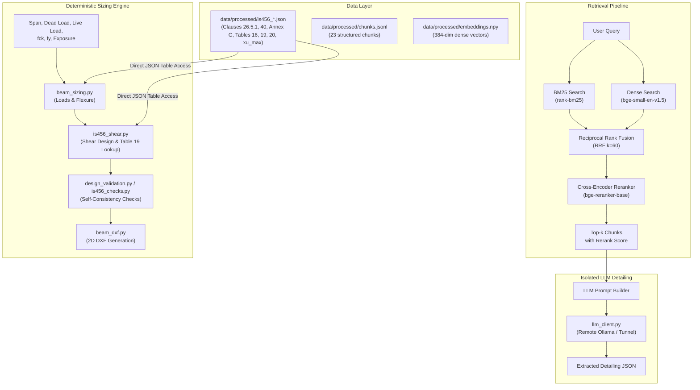

Status: draft pilot. Passes the implemented IS 456 beam detailing checks only. Not engineer-reviewed.

# System Architecture

## 1. Overview and Design Objectives

This repository implements a modular structural engineering assistant and information retrieval system for selected clauses and tables of **IS 456:2000** (Indian Standard Plain and Reinforced Concrete - Code of Practice).

The codebase separates deterministic structural mechanics from semantic information retrieval and generative language modeling:
1. **Deterministic Sizing and Validation Engine**: Computes bending moments, shear forces, longitudinal steel areas, and stirrup spacing using deterministic formulas directly mapped from digitized standard tables and clauses.
2. **Hybrid Retrieval and Reranking Pipeline**: Indexes 23 digitized clause and table chunks using lexical BM25, dense semantic vector embeddings (`BAAI/bge-small-en-v1.5`), Reciprocal Rank Fusion (RRF), and cross-encoder reranking (`BAAI/bge-reranker-base`).
3. **2D CAD Drafting**: Automatically draws cross-sections and longitudinal elevation drawings of designed simply supported beams in DXF format using `ezdxf`.
4. **Isolated LLM Proposal Module**: Connects to an external Ollama instance to extract reinforcement proposals from retrieved clause text.

---

## 2. Core Subsystems

### 2.1 Retrieval Engine (`src/retrieval/`)
The retrieval pipeline delivers relevant clauses and tables for user queries without hallucinating clause text:
- **Lexical Search (`bm25_search.py`)**: Uses `rank-bm25` over tokenized text from `chunks.jsonl`.
- **Dense Vector Search (`dense_search.py`)**: Generates 384-dimensional dense vectors using HuggingFace's `BAAI/bge-small-en-v1.5` sentence transformer model, saved in `data/processed/embeddings.npy`. Similarity is computed via normalized dot product (cosine similarity).
- **Reciprocal Rank Fusion (`hybrid_search.py`)**: Merges BM25 and dense ranking results with a smoothing parameter $k = 60$:
  $$RRF\_Score(d) = \frac{1}{60 + rank_{BM25}(d)} + \frac{1}{60 + rank_{Dense}(d)}$$
- **Cross-Encoder Reranking (`rerank.py`)**: Passes candidate query-chunk pairs into `BAAI/bge-reranker-base` to generate a relevance logit score.
- **Pipeline Facade (`pipeline.py`)**: Exposes `retrieve(query, k=3)`. Loads chunk metadata once into memory and returns top-$k$ verified text chunks.

### 2.2 Sizing and Mechanics Engine (`src/generation/beam_sizing.py`, `src/validation/`)
The beam sizing code calculates cross-section dimensions and reinforcement detailing:
- **Direct Table Reading**: Sizing functions read directly from `data/processed/is456_table_19.json`, `is456_table_20.json`, and `is456_xu_max_table.json`. Sizing code does not call the retrieval pipeline and does not interact with the vector index.
- **Flexural Sizing**: Evaluates neutral axis limiting ratio $x_{u,\max}/d$ from Table under Cl. 38.1 and limiting moment capacity $M_{u,\lim} = 0.36 (x_{u,\max}/d)(1 - 0.42 x_{u,\max}/d) b d^2 f_{ck}$ per Annex G-1.1(c). Evaluates required tension steel $A_{st}$ using the quadratic formula from Annex G-1.1(b).
- **Shear Design (`src/validation/is456_shear.py`)**: Computes nominal shear stress $\tau_v = V_u / (b d)$ per Cl. 40.1. Looks up concrete design shear strength $\tau_c$ from Table 19 and verifies $\tau_v \le \tau_{c,\max}$ from Table 20. If $\tau_v > \tau_c$, computes shear carried by stirrups $V_{us} = V_u - \tau_c b d$ and required stirrup spacing per Cl. 40.4(a). If $\tau_v \le \tau_c$, applies minimum shear reinforcement spacing per Cl. 26.5.1.6.

### 2.3 LLM Client and Front-End Assistant (`src/generation/`)
- **LLM Tool-Calling Front-End (`design_assistant.py`)**: Connects the LLM as the conversational front-end for structural engineers. The LLM parses the engineer's natural language request, extracts structured parameters (`span_m`, `dead_load_kN_per_m`, `live_load_kN_per_m`, `fck`, `fy`, `exposure`, `b`, `support_width_mm`), calls the deterministic sizing tool `size_beam_from_loads`, and explains the results with verified IS 456:2000 clause citations (Cl. 19.2.1, Cl. 22.2(a), Cl. 36.4.1/Table 18, Cl. 38.1 & Annex G, Cl. 40, Cl. 23.2.1 [F1: approximate curve fit, not from IS 456], Cl. 26.2.1 & 26.2.3.3). The deterministic Python code in `beam_sizing.py` stays in charge of every number. A consistency guardrail (`verify_explanation_consistency`) checks that narrative values match calculation outputs, and the mandatory structural review disclaimer is strictly enforced.
- **LLM Client (`llm_client.py`)**: Interacts with an Ollama HTTP server via `/api/chat`. Accepts `OLLAMA_BASE_URL` and sends the authentication token in the `X-LLM-Token` header. Reads responses strictly from `message.content` (ignoring internal model reasoning traces).
- **Proposal Flow (`design_proposal.py`)**: Decoupled generative proposal flow that formulates a prompt containing retrieved clauses and queries the LLM for bar detailing. Detailing parameters are validated through `src/validation/is456_checks.py`.

### 2.4 2D CAD Drafting (`src/cad/beam_dxf.py`)
- Employs `ezdxf` to produce AutoCAD-compatible DXF files (version R2010).
- Builds two viewports:
  1. **Cross-Section (Section A-A)**: Shows beam width $b$, overall depth $D$, clear cover, closed stirrup outer loop, bottom tension bars, and top hanger bars.
  2. **Longitudinal Elevation**: Shows clear span, support bearing blocks, top and bottom reinforcement bars, distributed vertical shear stirrups, and anchorage hooks. Development length $L_d$ is evaluated per Cl. 26.2.1 and 26.2.1.1, with minimum support anchorage embedment ($L_d / 3$) per Cl. 26.2.3.3.
- Organized across dedicated CAD layers (`OUTLINE`, `REBAR_MAIN`, `REBAR_TOP`, `STIRRUPS`, `DIMENSIONS`, `ANNOTATIONS`, `TITLE_BLOCK`, `HATCH`).

### 2.5 API Service (`src/api/main.py`)
- Built on FastAPI. Exposes `GET /health`, `POST /v1/rag/query`, and `POST /v1/design/assistant`.
- Validates the `X-API-Key` header against `IS_RAG_API_KEYS`.
- Preloads retrieval models during startup lifespan.
- Records query details, returned chunk IDs, rerank scores, latency, and client key name to an append-only JSONL log at `data/audit/audit.jsonl`.

---

## 3. Engineering Assumptions

The following design decisions and parameters are not specified on the referenced IS 456:2000 pages and are implemented as engineering assumptions:

1. **Assumption: Load factor**: A single partial safety factor of 1.5 is multiplied against combined service dead and live loads ($w_u = 1.5(DL + LL)$) to calculate design moment $M_u$ and design shear force $V_u$. Other load combinations from Table 18 are not considered.
2. **Assumption: Default support width**: Effective span is calculated per Cl. 22.2(a) as $\min(\text{clear span} + d, \text{clear span} + \text{support width})$, with support bearing width defaulted to an assumed value of 300 mm when not provided by the user. (Unit weight of reinforced concrete is verified as 25.0 kN/m³ per Cl. 19.2.1).
3. **Assumption: Preliminary depth guess**: Preliminary trial effective depth uses $\text{span} / 14$ rounded up to the nearest 25 mm multiple (minimum 200 mm floor). The actual effective depth $d_{\text{actual}} = D - \text{cover} - \phi_{\text{stirrup}} - \phi_{\text{bar}} / 2$ is subsequently computed from the chosen bar geometry, aligning sizing calculations and CAD drawing.
4. **Assumption: Stirrup sizes tried**: Stirrup bar diameters are evaluated in a fixed trial sequence of 8 mm, then 10 mm, then 12 mm, choosing the first size yielding a calculated spacing of at least 100 mm.
5. **Assumption: Minimum spacing**: A practical fabrication floor of 100 mm is assumed for stirrup spacing. If the required spacing is below 100 mm, the design is flagged as `needs_review`.
6. **Assumption: Rounding to 5 mm**: Calculated stirrup spacing is rounded down to the nearest multiple of 5 mm (`math.floor(spacing / 5.0) * 5.0`) for construction detailing; spacing is never rounded up.
7. **Assumption: Table 19 row rule**: For concrete shear strength $\tau_c$, the lookup selects the table row where $p_t \le \text{calculated } p_t$ without linear interpolation (if $p_t < 0.15$ the first row is selected; if $p_t \ge 3.0$ the last row is selected).
8. **Assumption: Deflection modification factor F1**: The tension modification factor $F_1$ is evaluated using an approximate curve fit, not from IS 456 (Fig. 4 has not yet been digitized from the page). Deflection check results are indicative only. Fig. 4 covers $p_t$ from 0 to 3.0 and $f_s$ from 120 to 290 N/mm²: if $p_t > 3.0$ or $f_s > 290\text{ N/mm}^2$, status is set to `needs_review` with the note "Outside the range of Fig. 4"; if $f_s < 120\text{ N/mm}^2$, $f_s = 120\text{ N/mm}^2$ is used and noted. Upper limit on $F_1$ is 2.0 with no lower limit, and no lower bound on $p_t$.
9. **Assumption: 20 mm nominal maximum aggregate size**: Per Cl. 26.3.2(a), horizontal clear distance between main bars must be at least $\max(\phi_{\text{bar}}, \text{aggregate size} + 5\text{ mm})$. A 20 mm nominal maximum aggregate size (giving a 25 mm clearance floor) is assumed unless an alternative value is explicitly provided.

---

## 4. Not implemented

The following capabilities, member types, standards, and infrastructure components are not implemented in this repository:
- other IS codes
- columns
- slabs
- footings
- DWG
- amendment tracking
- incremental updates
- doubly reinforced and T-beams
- engineer feedback loop
- Docker
- CI/CD
- faithfulness and answer-relevancy evaluation
- multi-turn interactive conversational memory
- retrieval not used by the sizing code
